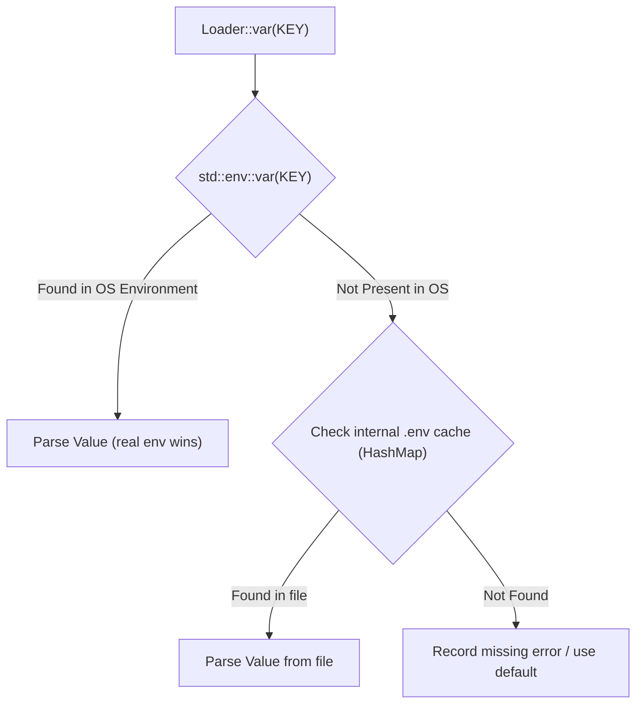

Tags: rust, systems-programming, configuration, open-source, architecture
Tech: RUST • STANDARD LIBRARY • CARGO

# Building Typedenv: Zero-Dependency Env Loading, Batch Error Accumulation, and the Rust 2024 Safety Dilemma

Every backend engineer has played the frustrating game of **"Configuration Whack-a-Mole"**:

You pull a new repository, boot up a microservice in Docker, and the startup immediately crashes:
```text
Error: environment variable `DATABASE_URL` is not set
```
You open your `.env` file, populate `DATABASE_URL`, and restart the service:
```text
Error: environment variable `JWT_SECRET` is not set
```
You fix `JWT_SECRET`, run it again:
```text
Error: environment variable `PORT` has invalid value `eight-thousand`: invalid digit found in string
```

Standard Rust configuration workflows tend to use `std::env::var("KEY")?`, aborting on the very first missing or malformed value. In microservice and cloud-native environments, this creates a slow, tedious cycle of restarts.

To solve this, I built **[typedenv](https://github.com/KidusAlemayehu/typedenv)**: a zero-dependency Rust library designed around typed parsing (`FromStr`), batch error accumulation (`Loader`), and safe, in-memory `.env` file resolution.

Here is an architectural walkthrough of the problems I encountered, why Rust 2024 makes `.env` loading tricky, and how `typedenv` solves them.

---

## 1. The Design Goals

Before writing any code, I established four non-negotiable architectural constraints:

1. **Zero External Dependencies**: Standard library only. No heavy regex engines, no complex macro bundles.
2. **Batch Error Accumulation**: Never stop at the first error. Collect all configuration issues across the entire application and report them in a single, comprehensive diagnostics block.
3. **Strict Defaults**: A default value should only be used when an environment variable is **unset**. If a variable is present but malformed (e.g., `PORT=abc`), that is an operational misconfiguration that must trigger an error, not be silently swallowed.
4. **100% Safe Rust**: `#![forbid(unsafe_code)]` in production code.

---

## 2. The Rust 2024 Edition Dilemma: Why `set_var` is Now Unsafe

In Rust 2024, an important change landed in the standard library:
```rust
// In Rust 2024 edition:
pub unsafe fn set_var<K: AsRef<OsStr>, V: AsRef<OsStr>>(key: K, value: V)
```
Calling `std::env::set_var` is now officially **`unsafe`**.

### Why did Rust make `set_var` unsafe?
On Unix-like operating systems, the environment table is a process-global structure accessed via libc's `getenv`. When a multi-threaded process calls `setenv` or `unsetenv` while other threads are simultaneously querying `getenv`, memory corruption and data races can occur.

Traditional `.env` crates (like standard `dotenv`) work by parsing a `.env` file on disk and iterating over the keys to call `std::env::set_var`. In modern multi-threaded Rust servers (e.g., Tokio-based services running on Axum or Actix), doing this introduces data race hazards.

### The Solution: In-Memory Fallback Layer
Rather than mutating the operating system's process table, `typedenv` implements an in-memory fallback cache:



Because `Loader` never writes to the process-global environment table:
- **No data races**: Safe in concurrent, multi-threaded runtimes.
- **No `unsafe` blocks**: The crate runs under strict `#![forbid(unsafe_code)]`.
- **Precedence guarantees**: Real container/OS variables (e.g., injected by Kubernetes or Docker) always take precedence over local `.env` files.

---

## 3. How the Batch `Loader` Works Under the Hood

How do you write straight-line, ergonomic code without stopping on errors, and without forcing developers into deeply nested `match` statements?

The `Loader` uses an **error accumulation and placeholder** pattern:

```rust
#[derive(Debug, Default)]
pub struct Loader {
    errors: Vec<EnvError>,
    file: HashMap<String, String>,
}
```

When you call `loader.var::<u16>("PORT")`:
1. It queries the environment (and in-memory `.env` fallback).
2. If valid, it parses the string into `u16` and returns it.
3. If missing or invalid, it appends an `EnvError` to its internal `Vec` and returns a placeholder dummy value (`T::default()` or the provided default).

```rust
let mut cfg = typedenv::Loader::new();
let host: String = cfg.var_or("HOST", "127.0.0.1".into());
let port: u16 = cfg.var("PORT");
let db: String = cfg.var("DATABASE_URL");
let debug: bool = cfg.var_bool_or("DEBUG", false);

// The Gatekeeper:
cfg.finish()?;
```

### The Safety Gatekeeper: `#[must_use]` `finish()`

Because failed lookups return placeholder values to keep execution flowing, using those values before checking the loader would lead to silent corrupted state (`port = 0`, `db = ""`).

To prevent this bug, `finish()` consumes the loader and is annotated with `#[must_use]`:

```rust
#[must_use = "configuration errors are recorded in the returned Result and must be handled"]
pub fn finish(self) -> Result<(), Errors> {
    if self.errors.is_empty() {
        Ok(())
    } else {
        Err(Errors(self.errors))
    }
}
```

If any lookup failed, `finish()` yields an `Errors` collection that displays every problem clearly:

```text
3 configuration errors:
 - environment variable `DATABASE_URL` is not set
 - environment variable `JWT_SECRET` is not set
 - environment variable `PORT` has invalid value `eight-thousand`: invalid digit found in string
```

---

## 4. Delimited List Parsing with Element-Level Error Tracing

Configuring microservices frequently requires comma-separated lists, such as CORS origins, cluster seed nodes, or whitelisted IPs.

`typedenv` includes first-class delimited list parsing via `var_list` and `var_list_or`:

```rust
let hosts: Vec<String> = var_list("ALLOWED_HOSTS", ',')?;
let ports: Vec<u16> = var_list_or("EXTRA_PORTS", ',', vec![8080, 8443])?;
```

The parser automatically trims surrounding whitespace and drops empty items (`" a, b ,, c, "` $\rightarrow$ `["a", "b", "c"]`). 

If an item in the list fails to parse, it pinpoints the exact 1-based index and value in the error message:
```text
environment variable `EXTRA_PORTS` has invalid value `8080, http, 9000`: item 2 (`http`): invalid digit found in string
```

---

## 5. Real-World Web Application Architecture

Here is how `typedenv` structures application startup in production web services:

```rust
use typedenv::{Loader, Errors};

pub struct AppConfig {
    pub host: String,
    pub port: u16,
    pub database_url: String,
    pub jwt_secret: String,
    pub max_connections: u32,
    pub debug: bool,
    pub sentry_dsn: Option<String>,
    pub cors_origins: Vec<String>,
}

impl AppConfig {
    pub fn from_env() -> Result<Self, Errors> {
        let mut loader = Loader::new()
            .with_dotenv(".env")
            .with_dotenv(".env.local");

        let config = Self {
            host: loader.var_or("HOST", "127.0.0.1".into()),
            port: loader.var_or("PORT", 8080),
            database_url: loader.var("DATABASE_URL"),
            jwt_secret: loader.var("JWT_SECRET"),
            max_connections: loader.var_or("MAX_CONNECTIONS", 10),
            debug: loader.var_bool_or("DEBUG", false),
            sentry_dsn: loader.var_opt("SENTRY_DSN"),
            cors_origins: loader.var_list_or("CORS_ORIGINS", ',', vec!["*".into()]),
        };

        // Validate all lookups at once
        loader.finish()?;

        Ok(config)
    }
}

fn main() {
    let config = match AppConfig::from_env() {
        Ok(cfg) => cfg,
        Err(errs) => {
            eprintln!("❌ Fatal configuration error:\n{errs}");
            std::process::exit(1);
        }
    };

    println!("🚀 Server starting on {}:{}", config.host, config.port);
}
```

---

## 6. Key Takeaways

1. **Fast-feedback beats fail-fast at startup**: For microservice bootstrap, collecting every configuration issue upfront saves immense developer time compared to crashing on the first missing variable.
2. **Process mutation is often an anti-pattern**: Modifying global process state (`set_var`) to read a local configuration file creates thread-safety hazards. Managing file fallbacks in userland memory is clean, fast, and thread-safe.
3. **Ergonomics and safety can coexist**: Using placeholder returns paired with a mandatory `finish()` validation gate allows clean, straight-line configuration code without sacrificing compile-time safety.

---

### Resources

- **GitHub**: [github.com/KidusAlemayehu/typedenv](https://github.com/KidusAlemayehu/typedenv)
- **Crates.io**: [crates.io/crates/typedenv](https://crates.io/crates/typedenv)
- **Documentation**: [docs.rs/typedenv](https://docs.rs/typedenv)
